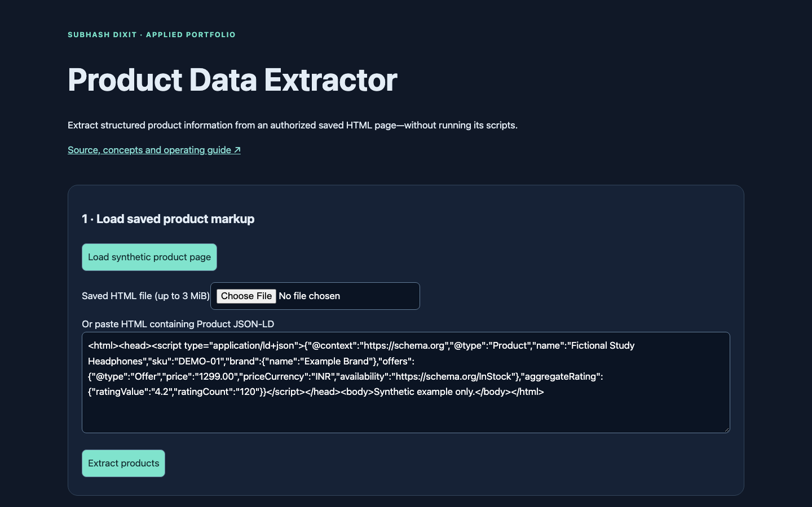
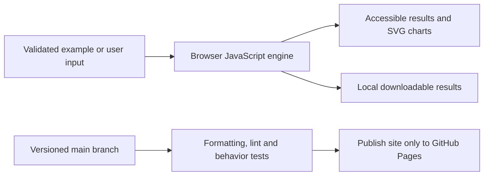
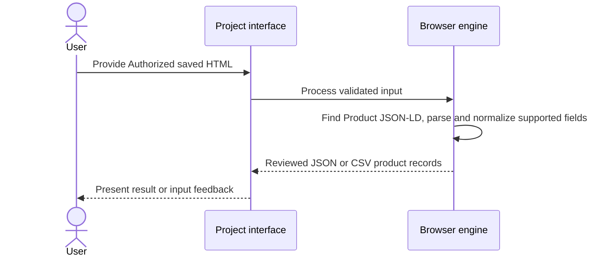
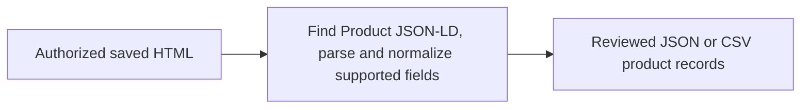

# Product Data Extractor

## 1. Project overview

Local saved-product-page JSON-LD extraction to reviewed JSON and CSV, without executing page scripts.

[Live demo](https://subhashdixit.github.io/product-data-extractor/) · [Source repository](https://github.com/subhashdixit/product-data-extractor)



## 2. Motivation and problem statement

### Objective

Extract reviewable product data from saved HTML with schema.org Product JSON-LD.

### Problem statement

Visual selectors change across product sites, while embedded structured records can be missing or malformed.

### Motivation

A local extractor makes missing fields and parse errors inspectable before export.

## 3. Solution and scope

**Inputs** — Authorized saved HTML. **Outputs** — Reviewed JSON or CSV product records.

### What the finished application does

- Paste or import saved HTML containing schema.org Product JSON-LD.
- Extract title, SKU, brand, offer price/currency, availability and aggregate ratings.
- Report malformed JSON-LD blocks, retain missing values and export JSON/CSV.
- Start with a clearly fictional product fixture.

## 4. Quick start and usage

### Use the application step by step

1. Open the live application. Read the input labels and scope panel.
2. Start with the included example to understand the output.
3. Replace it with your own supported input. Files are processed locally unless you explicitly choose a server feature and consent to it.
4. Run the analysis and inspect the visual output together with its limitations.
5. Export your results when the tool offers a download. Keep your own copy; a browser tab is not a durable data store.

## 5. High-level architecture

### Architecture and data flow



HTML provides the accessible page structure, CSS handles responsive layout, and ES modules separate calculation from user interaction. Pure calculation functions can run in Node tests without a browser. SVG charts scale with the screen; they use explicit axes, labels and legends. CSV exports escape spreadsheet formula prefixes in text cells.

## 6. End-to-end request workflow



## 7. Data sources, inputs, and outputs

| Input | Processing | Output |
| --- | --- | --- |
| Authorized saved HTML | Find Product JSON-LD, parse and normalize supported fields | Reviewed JSON or CSV product records |

### Data provenance and attribution

Original Flipkart_Scrapper files and historical CSVs are preserved outside the published site. Default HTML describes a fictional product. JSON-LD vocabulary: [schema.org Product](https://schema.org/Product), [Offer](https://schema.org/Offer) and [AggregateRating](https://schema.org/AggregateRating).

## 8. Data flow and ETL pipeline



## 9. Low-level design and interfaces

Implementation entry points are [`site/index.html`](<site/index.html>), [`site/app.js`](<site/app.js>), [`site/engine.js`](<site/engine.js>).

## 10. Concepts and algorithms

### Concepts, algorithms and interpretation

#### Why structured data?

Many product pages include JSON-LD for search engines. It is more explicit than visual CSS selectors: a price field has semantic meaning independent of where it appears. The extractor reads only application/ld+json blocks, walks arrays/@graph and Product objects, and normalizes bounded numeric fields. It never executes imported scripts or appends imported HTML to the page. A malformed block is counted rather than silently treated as a zero-price product.

AggregateOffer lowPrice is used when a direct price is absent; this means the lowest listed offer, not a guaranteed checkout price. Arrays of offers use the first listed offer, which may not be the best or current one. Ratings/counts are source declarations, not independently verified review quality. A valid parse confirms syntax and mapping, not truth.

## 11. Technology choices and dependencies

- **HTML, CSS, and JavaScript**. Serve a static browser interface with inspectable rendering and validation.

[Dependency versions and runtime rationale](DEPENDENCIES.md)

## 12. Training, inference, and evaluation

Review behavior using the checked-in fixtures and assertions. This application has no project-trained model benchmark.

Validation code is available in [`tests/engine.test.js`](<tests/engine.test.js>).

## 13. Limitations and data handling

### Practical limits

This is an authorized saved-page/import workflow, not a live Flipkart crawler. No anti-bot challenge bypass, account scraping, automatic review harvesting or current-price promise. Some sites omit JSON-LD or render it only after client execution; such input produces no Product objects. Up to 3 MiB, 100 blocks/products, depth20 and 20,000 visited nodes. Exported data can be stale.

The test suite checks calculation contracts and invalid inputs. It cannot establish that an input dataset is representative, that a heuristic is scientifically correct for every domain, or that a result is suitable for an automated consequential decision. Read the original source alongside the maintained browser implementation when comparing behavior.

## 14. Installation and local setup

### Run locally from scratch

Install Node.js 22 and Python 3 for a local static HTTP server. Python is not a production backend for this app.

```bash
git clone https://github.com/subhashdixit/product-data-extractor.git
cd product-data-extractor
npm ci
npm test
npm run lint
npm run format
npm run check
python3 -m http.server 8000 --directory site
```

Open http://localhost:8000. Use HTTP rather than double-clicking HTML so that module imports and local data fetches work consistently. No production API secret belongs in `site/`.

### Local dependency installation

The maintained app is HTML/CSS/JavaScript and needs no Python packages. `requirements.txt` documents this; install development tools with `npm ci` using the pinned Node/npm versions. See [DEPENDENCIES.md](DEPENDENCIES.md). Original prototype requirements are preserved at `archive/prototype-requirements.in` where present; they are not the supported install command.

## 15. Repository structure

### Coding structure

```text
site/
  index.html       # accessible application interface
  styles.css       # responsive design
  app.js           # interface orchestration
  engine.js        # validated calculations; no DOM dependency
  ui.js            # chart, CSV and download helpers
tests/             # behavior and boundary cases
.github/workflows/pages.yml
archive/           # original README and retired workflows where present
```

Original source files, notebooks and historical artifacts remain in the repository for comparison. The release publishes only `site/`; old source directories and datasets are not automatically exposed by the application.

## 16. Deployment and operations

### CI/CD and deployment

CI means continuous integration: each pull request and main-branch push installs exact lockfile dependencies, checks formatting, lints JavaScript, runs meaningful behavior tests and checks module syntax. A failed check stops publishing. CD means continuous deployment: after the required `Build and test` check succeeds on `main`, GitHub Actions uploads `site/` and GitHub Pages serves it over HTTPS.

The workflow uses pinned action revisions, minimal permissions and a protected main branch. Publishing jobs need Pages/OIDC permissions; test jobs only read source. Feature branches are deleted after merge. Static Pages hosting needs no always-running Python process, but cannot hide secrets, host a Flask process or provide durable server storage.

To set up a fork, enable GitHub Pages with **GitHub Actions** as its source and allow the repository's workflow to run. Repository Settings → Pages shows the deployment URL. If renaming the repository, update the README URL and any absolute links; application resources use relative paths. Check Actions logs if publishing fails.

#### Release, monitoring and rollback

A commit identifies exactly which source was deployed. Inspect the Actions deployment and test results before sharing the link. After publishing, open the page, run its example and check exports; a successful HTTP response alone is not a functional test. For rollback, revert the faulty merge in a new PR, pass checks, and merge the revert. This triggers the same reproducible publishing process. Avoid force-pushing protected main or deleting history. Browser caches can retain an older asset briefly; refresh after a deployment.

#### Docker and alternatives

Docker packages code and dependencies into a reproducible runtime. This static app does not require a container: Pages serves the same versioned files directly, with less operating work and no container cold starts. A container becomes useful if adding a Python backend; then secrets, patches, resource costs and persistent storage require separate management.

## 17. License, credits, and support

The repository does not contain a root LICENSE file. Check upstream and data-source terms before reuse. Report reproducible issues through [GitHub Issues](https://github.com/subhashdixit/product-data-extractor/issues).
